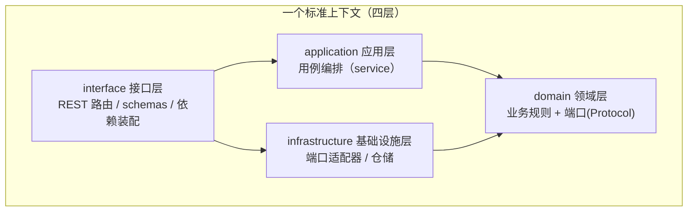
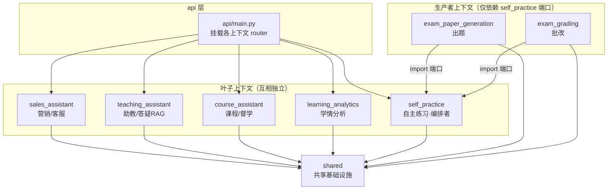
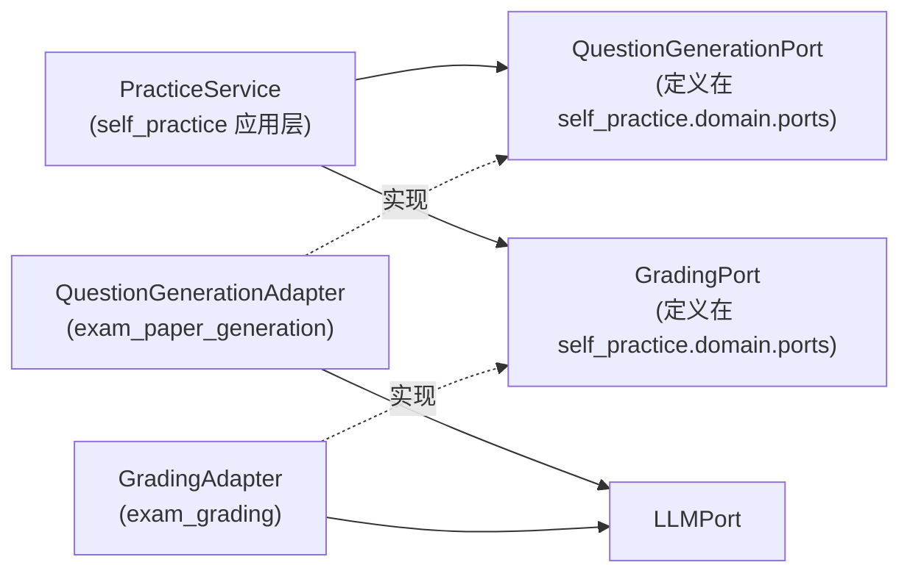

# 码帮智 · 教育智能体平台 — 架构说明

## 2.运行测试

### 环境要求

- 测试环境使用 conda `myenv`（Python 3.10，路径 `E:\anaconda3\envs\myenv`）。
- 项目自带的 `.venv`（Python 3.13）**不含** RAG 重依赖（torch / Milvus / sentence-transformers），真实集成测试会在其中被自动跳过。

### 运行步骤

在项目根目录执行（`pytest` 的 `testpaths=["tests"]` 与数据库相对路径都依赖项目根目录）：

```bash
cd D:\projects\项目阶段\ai-assistant-platform
```

方式 A（先激活 myenv）：

```bash
conda activate myenv
python -m pytest -q
```

方式 B（直接用完整路径，不激活）：

```bash
E:\anaconda3\envs\myenv\python.exe -m pytest -q
```

### 常用命令

| 目的 | 命令 |
|------|------|
| 全量测试 | `python -m pytest -q` |
| 详细输出 | `python -m pytest -v` |
| 只跑销售助手 | `python -m pytest tests/contexts/sales_assistant/ -q` |
| 只跑服务层测试 | `python -m pytest tests/contexts/sales_assistant/test_sales_service.py -v` |
| 只跑真实集成测试（BGE-M3 + Milvus） | `python -m pytest tests/contexts/sales_assistant/test_knowledge_base_integration.py -v` |
| 跳过集成测试（快速跑） | `python -m pytest -q --ignore=tests/contexts/sales_assistant/test_knowledge_base_integration.py` |

### 预期结果

- 全量：**198 passed**（197 单元测试 + 1 真实集成测试）。
- 真实集成测试会加载 BGE-M3 模型（首次约 10~15 秒）。
- 若出现 `DeprecationWarning: ranker_type/ranker_params is deprecated`，这是 langchain-milvus 0.4.0 的弃用告警，不影响结果，可忽略。

## 3.启动服务 + Swagger 测试

### 启动

在项目根目录、conda `myenv` 环境下：

```bash
cd D:\projects\项目阶段\ai-assistant-platform
conda activate myenv
python -m uvicorn api.main:app --reload --port 8000
```

（`--reload` 可选，改代码自动重启；纯测试可去掉。）

### Swagger

浏览器访问：

```
http://127.0.0.1:8000/docs
```

### 测试 sales 接口

Swagger 里找到 **POST `/api/v1/sales/chat`** → **Try it out** → 填 body：

```json
{
  "conversationId": null,
  "message": "报名流程是怎样的？",
  "source": "web"
}
```

返回体 `data` 字段：`reply`（回复）、`direction`、`position`、`courses`、`leadSaved`、`sources`（FAQ 溯源）。

### 两个前提

1. **不配 LLM 只能测接口通断**：默认 `llm_provider=fake`（无 `.env` 时），fake LLM 无法识别意图，`chat` 只会返回方向引导话术，走不到 FAQ 检索分支。要真正测 FAQ，需在项目根新建 `.env`：

   ```env
   LLM_PROVIDER=deepseek
   DEEPSEEK_API_KEY=你的key
   DEEPSEEK_BASE_URL=https://api.deepseek.com
   DEEPSEEK_MODEL=deepseek-chat
   ```

   改完 `.env` 后重启 uvicorn（`--reload` 对 `.env` 不一定触发，手动重启最稳）。

2. **测 FAQ 前先建知识库**：

   ```bash
   python -m contexts.sales_assistant.infrastructure.build_knowledge_base
   ```

   把 `contexts/sales_assistant/data/faq.md` 写入 `data/milvus_sales_faq.db`。不建库时 FAQ 分支会降级返回「抱歉…转顾问老师」兜底话术（不报错，只是没有语义答案）。

### 快速验证顺序

1. 先只启动服务，测 `GET /health` → 确认服务起来。
2. 建库 → 配 `.env` → 重启 → 测 `POST /api/v1/sales/chat`，message 填 FAQ 问题（如「报名流程是怎样的？」），看 `data.sources` 是否有内容。

> 本文档描述当前代码库的架构、模块划分与领域之间的依赖关系。
> 领域（bounded context）的详细说明见各 `contexts/<name>/README.md`。

## 1. 概述

平台是一个**后端 AI 智能体中台**，覆盖「售前获客 → 课程匹配 → 学习规划 → 课后答疑 → 过程督学 → 自主练习 → 学情分析」全链路。采用 **DDD（限界上下文）+ 端口与适配器（Ports & Adapters）** 架构，模块化单体起步，通过接口隔离，某个上下文负载或团队需要时再拆微服务。

**技术栈**：Python 3.13 / FastAPI / SQLAlchemy 2.x / Pydantic v2 / DeepSeek（可注入 Mock）/ SQLite（默认，可切 MySQL）。

## 2. 分层架构

上下文内部**按需采用 2~4 层**：标准上下文四层齐全；生产者上下文（`exam_paper_generation`、`exam_grading`）只有 domain + infrastructure 两层（见 §4/§5）。标准四层的依赖方向从外向内，**domain 层不依赖任何外层**：



> 依赖倒置：application 与 infrastructure **都**依赖 domain 的端口（Protocol），二者互不 import。interface 是组合根，同时装配 application 与 infrastructure 的具体实现。

| 层 | 职责 | 依赖方向 |
|----|------|---------|
| **interface** | 对外入口（FastAPI 路由）、请求模型、依赖注入装配（组合根） | → application + infrastructure |
| **application** | 用例编排，不落具体技术细节 | → domain（含端口） |
| **domain** | 纯业务规则、端口协议（Protocol）、领域类型 | 不依赖任何外层 |
| **infrastructure** | 端口适配器、仓储、LLM/DB/消息等具体实现 | → domain（实现其端口） |

**依赖规则**（由 `.importlinter` 强制执行）：

- `shared` 不依赖 `contexts` / `orchestrator` / `api`
- 叶子上下文互相独立
- 生产者上下文只允许依赖 `self_practice` 的端口

## 3. 顶层模块

```
ai-assistant-platform/
├── api/                     # FastAPI 外壳：create_app、路由挂载、异常处理、健康检查
├── contexts/                # 7 个限界上下文（业务领域）
├── orchestrator/            # 意图路由骨架（当前为空占位）
├── shared/                  # 共享基础设施（纯技术能力）
│   ├── common/              #   exception（统一异常/错误码）、util
│   └── infrastructure/      #   config、db、llm、memory、observability、tool_registry、web
└── docs/                    # 规格 / 计划 / 本文档
```

### shared 基础设施清单

| 模块 | 职责 |
|------|------|
| `config` | 环境配置（`get_settings`） |
| `db` | `Base` / `utcnow`、session、SQLAlchemy 模型（见 §6） |
| `llm` | `LLMPort` 协议、DeepSeek 适配器、`FakeLLMAdapter`（测试）、`get_llm` 工厂 |
| `memory` | `MemoryPort` 协议 + 内存实现（会话状态） |
| `observability` | structlog 日志、traceId 中间件 |
| `tool_registry` | 工具注册表（按 context 命名空间隔离） |
| `web` | 统一响应 `ApiResponse` + `ok()` |

## 4. 上下文清单

| 上下文 | Agent | 定位 | 分层 | 对外 API |
|--------|-------|------|------|---------|
| `sales_assistant` | 营销 Agent | 智能客服 / 线索留资 | 4 层 | `/api/v1/sales/*` |
| `teaching_assistant` | 助教 Agent | 答疑 RAG / 转人工 | 4 层 | `/api/v1/teaching/*` |
| `course_assistant` | 课程 Agent | 路径规划 + 督学 | 4 层 | `/api/v1/course/*` |
| `learning_analytics` | 学情分析 Agent | 画像 / 趋势 / 薄弱点 | 4 层 | `/api/v1/analytics/*` |
| `self_practice` | 自主练习 Agent | **编排者**：练习闭环 | 4 层 | `/api/v1/practice/*` |
| `exam_paper_generation` | 出题 Agent | 生产者：出题 | 2 层（无 interface/application） | 无 |
| `exam_grading` | 评价 Agent | 生产者：批改 | 2 层（无 interface/application） | 无 |

> 出题与批改为「生产者」上下文，仅被 `self_practice` 通过端口调用，不对外暴露 API，因此省略 interface 与 application 两层。

## 5. 领域依赖关系



**依赖规则解读：**

1. **所有上下文都依赖 `shared`**（LLM、DB、统一响应、日志等纯技术能力）。
2. **`api` 依赖所有上下文的 `interface` 路由**，是唯一把各领域装配起来的地方。
3. **五个叶子上下文互相独立**（`sales / teaching / course / analytics / self_practice` 之间不 import）。
4. **出题 / 批改是「生产者」**：单向依赖 `self_practice.domain.ports`（import `Question` / `GradeResult` / 端口协议），但不依赖任何叶子上下文。`self_practice` 反过来不知道它们的存在。

## 6. 端口与适配器（自主练习闭环）

`self_practice` 是编排者，在**自己的 domain 里定义它需要的端口**（消费者驱动契约），出题 / 批改上下文各自实现这些端口，运行时通过依赖注入装配：



- `PracticeService` 只认 `QuestionGenerationPort` / `GradingPort` 两个协议，不 import 具体适配器。
- 具体适配器在 `self_practice/interface/dependencies.py` 注入（组合根），是唯一把三者连起来的地方。
- 好处：删除 `exam_paper_generation` / `exam_grading` 目录，`self_practice` 的 domain / application 不受影响，只有 `dependencies.py` 一处 import 报错。

**运行时调用链**：`self_practice` →（通过端口）→ 出题 / 批改 → `LLMPort`；结果回流 `self_practice` 持久化，供 `learning_analytics` 下游消费。

## 7. 数据模型分组

`shared/infrastructure/db/models/` 下分两组：

| 分组 | 文件 | 表 | 用途 |
|------|------|-----|------|
| **同步缓存** | `sync_cache.py` | `course` / `chapter` / `video` / `video_annotation` / `student` / `student_course` / `student_video_progress` 等 | 从外部系统同步的只读参考数据 |
| **业务** | `business.py` | `lead` / `practice_session` / `practice_question` / `practice_answer` / `learning_profile` / `mastery_trend` / `weak_point` / `conversation_message` | 本平台自身产生的业务数据 |

## 8. 运行时装配

- `api/main.py::create_app()` 注册 TraceId 中间件、异常处理器、健康检查与 6 个上下文的 router。
- 每个上下文在 `interface/dependencies.py` 用 FastAPI `Depends` 装配 service，注入 `LLMPort` 与各端口适配器。
- 测试用 `sqlite://` 内存库 + `FakeLLMAdapter` + `app.dependency_overrides` 覆盖依赖。

## 9. 相关文档

- 需求规格说明书：`docs/码帮智 · 教育智能体平台需求规格说明书.md`
- 技术设计说明书：`docs/码帮智 · 教育智能体平台系统技术设计说明书.md`
- 分阶段实施设计：`docs/superpowers/specs/2026-11-17-implementation-phasing-design.md`
- 依赖规则配置：`.importlinter`